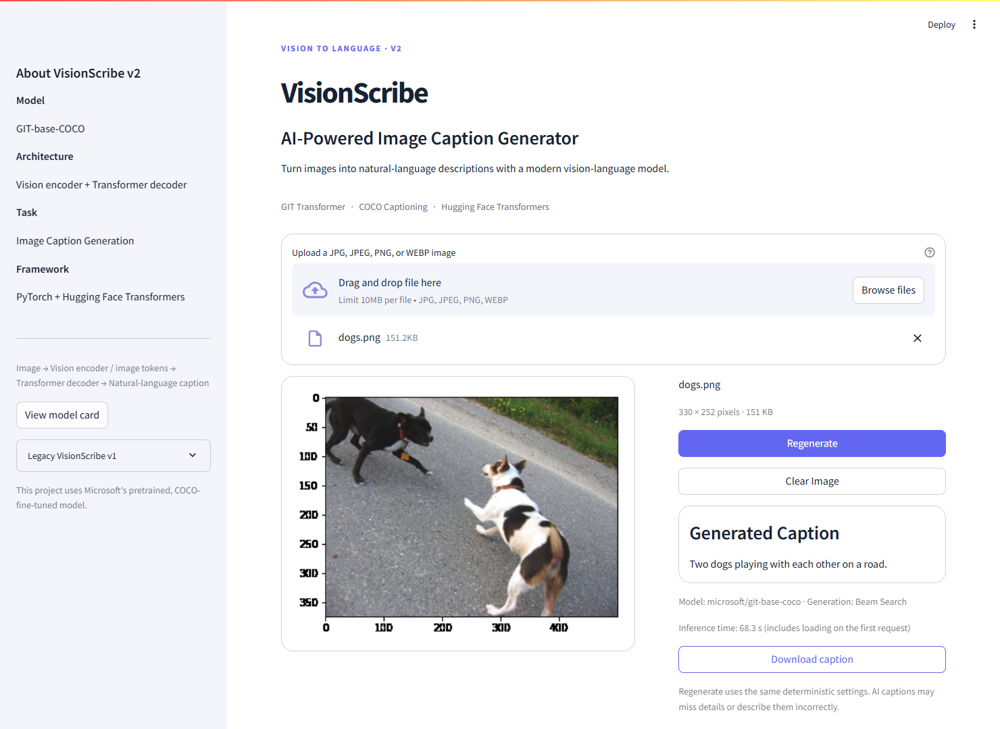

# VisionScribe
## AI-Powered Image Caption Generator

## Overview

VisionScribe v2 turns photos into concise natural-language captions using
Microsoft's pretrained **GIT-base-COCO** vision-language transformer. Its Streamlit
interface provides a large image preview, explicit generation, progress updates,
and downloadable captions. This project uses the published model for inference;
it does not train GIT from scratch or fine-tune it.

## Live Demo

[Live Demo](https://image-caption-generator-mvzdrcuzwoepbfhnzmsa4b.streamlit.app)
· [GitHub Repository](https://github.com/keshav1234567891011/VisionScribe-AI-Image-Caption-Generator)

The existing deployment URL is retained. The hosted app becomes v2 after these
changes are pushed and the Streamlit deployment rebuilds.

## Screenshot



This is an actual local v2 interface capture. The older deployed interface is
preserved alongside the legacy implementation.

## Features

- JPG, JPEG, PNG, and WEBP uploads with content validation, EXIF correction, and RGB conversion.
- A two-column image preview and caption workspace.
- Deterministic beam-search captions; Regenerate uses the same settings.
- Clear Image and `caption.txt` download controls.
- Lazy model loading with visible loading, analysis, and generation stages.
- Cached model and processor reused across Streamlit reruns and sessions.
- Friendly errors for invalid images, model/network failures, and detectable memory failures.
- Lightweight offline unit tests plus an explicitly enabled real-model test.

## VisionScribe v2

V2 replaces the educational v1 backend with a pretrained transformer to address
its limited vocabulary, weak generalization on real-world photos, and greedy
decoding. The active app loads **one GIT model**. It never loads the legacy ML
stack or its saved artifacts.

V2 demonstrates vision-language inference, beam search, deployment, resource
management, and a practical UI. The v1 implementation remains available for
learning about CNN feature extraction and recurrent caption generation.

## How It Works

1. Validate file content and limits: **10 MB** and **16 million pixels**.
2. Correct camera orientation and convert the decoded image to RGB.
3. The Hugging Face processor performs GIT-specific resizing and normalization.
4. GIT's CLIP vision encoder represents the image as visual tokens.
5. Its transformer text decoder predicts tokens conditioned on those visual tokens.
6. Deterministic beam search generates a caption until the model's end token or
   the configured new-token limit.
7. The processor decodes with `skip_special_tokens=True`. Display formatting only
   normalizes whitespace, capitalizes the initial character, and adds punctuation
   when needed; it does not invent objects or rewrite facts.

## Architecture

```text
Uploaded Image
      ↓
Image validation / EXIF correction / RGB conversion
      ↓
GIT Image Processor
      ↓
CLIP vision representation / image tokens
      ↓
Transformer caption decoder
      ↓
Beam-search generation
      ↓
Natural-language caption
```

| Module | Responsibility |
| --- | --- |
| `main.py` | Upload UI, session state, progress, preview, results, and download |
| `caption_generator.py` | Cached loaders, device selection, generation settings, inference, and model errors |
| `utils.py` | Image validation/conversion and sentence formatting |

The inference module exposes `load_processor()`, `load_caption_model()`, and
`generate_caption(image)`. Heavy libraries are imported lazily. The model uses
`eval()` and `torch.inference_mode()`; a lock serializes requests sharing the
cached model to avoid simultaneous beam-search allocations. Uploads and image
tensors are not cached globally. Session state retains the upload identity,
caption, and timing, plus a counter used to reset the uploader widget.

## Model

- **Checkpoint:** [microsoft/git-base-coco](https://huggingface.co/microsoft/git-base-coco)
- **Architecture:** GIT (Generative Image-to-Text), a CLIP image encoder with a transformer text decoder.
- **Training provenance:** published pretrained model, fine-tuned for COCO image captioning; reused by this project.
- **API:** Transformers 4.49.0 `AutoProcessor` / `GitForCausalLM`, without a pipeline or remote custom code.
- **Pinned revision:** `a13141da42abd4a8cbf283601a8104265f537cee`.
- **License:** MIT according to the [model card](https://huggingface.co/microsoft/git-base-coco).

| Generation parameter | Value | Purpose |
| --- | --- | --- |
| `num_beams` | `3` | Explore alternatives without the extra cost of four beams |
| `max_new_tokens` | `40` | Bound output length and CPU work |
| `no_repeat_ngram_size` | `2` | Prevent repeated two-token phrases |
| `early_stopping` | `True` | Finish beam search once sufficient completed candidates exist |
| `do_sample` | `False` | Deterministic caption generation |

These are named constants in `caption_generator.py`. They are practical captioning
settings, not creative-story parameters. No BLEU, CIDEr, or accuracy result is
claimed for v2.

See [local validation notes](docs/v2-validation.md) for the beam comparison,
qualitative examples, timing/memory observations, and why dynamic quantization
was tested but rejected. The production model remains full precision.

The public checkpoint needs no API key. Its approximately 707 MB weight file is
downloaded at first use into Hugging Face's normal cache, **outside Git tracking**.
The loader requests only the required checkpoint files, then loads the cached
snapshot locally. Accelerate enables reduced-memory loading. The original weight
file is never copied into the project or committed.

## Tech Stack

- Python **3.11**
- Streamlit **1.41.1**
- PyTorch **2.6.0**, using CPU wheels by default on Linux/Windows
- Hugging Face Transformers **4.49.0**
- Accelerate **1.4.0** for reduced-memory loading
- Hugging Face Hub **0.36.2** for revision-pinned cache downloads
- Pillow **11.3.0**
- pytest **8.3.5** (development only)

Production dependencies contain only the v2 stack. The CPU-wheel selection avoids
installing unnecessary CUDA libraries on Community Cloud. Code selects CUDA when
available, otherwise CPU; a GPU environment would need a matching GPU PyTorch
installation instead of the default CPU wheel. macOS uses the standard torch wheel.

## Project Structure

```text
.
├── main.py
├── caption_generator.py
├── utils.py
├── requirements.txt
├── requirements-dev.txt
├── requirements-legacy.txt
├── pytest.ini
├── tests/
│   ├── conftest.py
│   ├── test_caption_generator.py
│   ├── test_images.py
│   ├── test_ui.py
│   └── test_model_integration.py
├── .streamlit/config.toml
├── .github/workflows/tests.yml
├── docs/images/visionscribe-v2.png
├── legacy/                       # Preserved v1 implementation and artifacts
│   ├── main.py
│   ├── caption_generator.py
│   ├── utils.py
│   ├── best_model.h5
│   ├── tokenizer.pkl
│   ├── image-caption-generator.ipynb
│   ├── tests/
│   └── README.md
├── .gitignore
└── README.md
```

## Installation

With Python 3.11 installed:

```bash
git clone https://github.com/keshav1234567891011/VisionScribe-AI-Image-Caption-Generator.git
cd VisionScribe-AI-Image-Caption-Generator
python -m venv .venv
```

Activate on Windows PowerShell:

```powershell
.venv\Scripts\Activate.ps1
```

Or macOS/Linux:

```bash
source .venv/bin/activate
```

Install the production dependencies:

```bash
python -m pip install --upgrade pip
python -m pip install -r requirements.txt
```

Use a fresh environment for v2. Do not install `requirements-legacy.txt` into it.
Network access and sufficient disk space are needed for the initial model download.

## Running Locally

```bash
streamlit run main.py
```

Open the URL printed in your terminal. Upload a photo and choose **Generate
Caption**. The page opens without loading the model. The first generation request
loads it; later interactions reuse cached resources. Clear Image resets this
session's upload and caption without clearing model resources. Timing includes
model loading on the first request.

## Testing

```bash
python -m pip install -r requirements-dev.txt
python -m pytest -v
python -m py_compile main.py caption_generator.py utils.py
python -m pip check
```

Unit tests mock all pretrained loaders and explicitly enable Hugging Face offline
mode. They cover upload formats, RGB, EXIF, corrupt/unsupported/oversized files,
formatting, caching, eval mode, inference mode, device selection, generation
arguments, decoding, loading/inference errors, and Streamlit reset/rerun behavior.
The Python 3.11 CI workflow runs these tests without downloading model weights.

The optional integration test requires an actual local photo and explicit opt-in.
It can download the checkpoint if not already cached, runs two deterministic
captions, checks cached model identity, and verifies the legacy backend is absent.

Windows PowerShell:

```powershell
$env:RUN_MODEL_INTEGRATION = "1"
$env:CAPTION_TEST_IMAGE = "C:\path\to\photo.jpg"
python -m pytest tests/test_model_integration.py -v -s
```

macOS/Linux:

```bash
RUN_MODEL_INTEGRATION=1 CAPTION_TEST_IMAGE=/path/to/photo.jpg python -m pytest tests/test_model_integration.py -v -s
```

No dataset is downloaded by tests. Integration is skipped unless requested.

## Deployment

1. Push the v2 files to the repository used by the existing Streamlit app.
2. Keep **`main.py`** as the entry point and choose **Python 3.11**.
3. Let Community Cloud rebuild using **`requirements.txt`**, then reboot once to
   discard the previous process and dependency environment.
4. Open the app and test one generation after the first-use download.

Do not configure an API token for this public model. Keep the Hub cache untracked;
do not add weights to Git or install the legacy dependency file on Cloud. The
upload cap and theme live in `.streamlit/config.toml`, which also suppresses
technical error details in the UI.

Only one model is resident, CPU threads are limited to two, and inference requests
are serialized. These reduce avoidable memory and CPU pressure. Actual capacity
depends on the host's allocation, image sizes, and framework overhead; Community
Cloud resource limits can change. Monitor the first deployed request and its
logs rather than assuming local measurements guarantee Cloud capacity.

Local three-beam testing used roughly **1 GB of resident process memory** and
caption generation took **tens of seconds on CPU**. This exceeds a 690 MB memory
budget; a host needs additional room for Streamlit, decoded uploads, and other
sessions. See the [measured validation notes](docs/v2-validation.md). A successful
dependency install does not establish that the deployed allocation is sufficient.

## Streamlit Community Cloud and App Sleep

Community Cloud may hibernate inactive apps. This is hosting behavior, not a
VisionScribe bug. Visit the app and use the host's wake control when shown. The
first request after a process restart may take longer because model resources
must load again; the persistent disk cache is also controlled by the host.

VisionScribe displays loading and generation stages and caches resources for the
process lifetime. It does not generate fake traffic or use keep-alive hacks.
An always-on deployment requires a hosting service or tier that supports it.
See [Streamlit's app-management documentation](https://docs.streamlit.io/deploy/streamlit-community-cloud/manage-your-app).

## Legacy VisionScribe v1

V1 used **VGG16 + LSTM + Flickr8k**, extracting 4096-dimensional `fc2` features
and generating words greedily with a 35-index pre-padded sequence. It is retained
under [legacy/](legacy/README.md), including the original H5, tokenizer, notebook,
reference UI, tests, and documentation. The three original artifacts are unchanged.

The notebook contains a Flickr8k training workflow; the artifacts were supplied
with the original project. The available history does not establish the original
trainer or external upstream source. V1 remains useful for explaining transfer
learning, CNN features, tokenization, LSTM sequences, and greedy decoding.

Historical V1 notebook outputs include BLEU-1 `0.533212` and BLEU-2 `0.305637`.
They are not reproduced here and are **not v2 performance metrics**. Dataset
files and the exact split manifest are absent; scoring included sequence markers.

To run the archived app, use a **separate** environment with
`requirements-legacy.txt`, then `streamlit run legacy/main.py` from the repository
root. Never run both backends in the production process.

## Limitations

- Captions can hallucinate objects, miss details, or misinterpret unfamiliar scenes.
- The COCO-fine-tuned model targets English everyday-image captions, not exhaustive descriptions or reliable OCR.
- Beam search and phrase constraints improve control but do not guarantee factual accuracy.
- CPU inference and the first checkpoint download can take noticeable time.
- A host that terminates the process for memory exhaustion cannot be recovered by a Python exception handler.
- No quantitative v2 quality benchmark or universal improvement claim is made.

## Future Improvements

- Evaluate factuality and caption metrics on a documented, licensed held-out set.
- Expand qualitative tests across unfamiliar scenes and accessibility needs.
- Compare smaller or optimized captioning backends under the same CPU/memory budget.
- Add batch captioning only after measuring deployment capacity.

## Credits / Attribution

Microsoft's [GIT-base-COCO model card](https://huggingface.co/microsoft/git-base-coco)
and the [GIT project](https://github.com/microsoft/GenerativeImage2Text) provide
the v2 model foundation. Model licensing is MIT according to the model card; this
does not establish a license for the legacy artifacts or the entire repository.
The project's additions are its inference integration, UI, validation, caching,
resource controls, tests, CI, and deployment documentation.

The supplied earlier implementation is preserved as v1 with its training notebook
and artifacts. No verified upstream source link or license was found for v1, so
none is invented. Acknowledgements also to Hugging Face, PyTorch, Streamlit,
Pillow, and the COCO and Flickr8k dataset creators.
